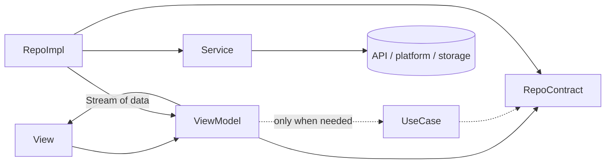

# Flutter Bloc Boilerplate

An enterprise Flutter starter for apps that sign in, land on a main shell, and load data from an API. The UI is views and Cubit view models. Repositories own data. A pure-Dart `domain` folder holds the models and the contracts. Features stay isolated, and an architecture test fails the build when a layer imports something it should not.

The Dart package is `enterprise_mvvm`. The folder you clone is `flutter_bloc_boilerplate`. Flutter **3.47.7** / Dart **3.13.5** (`sdk: ^3.13.5`).

Most apps that start from this repo need one role. That path is the default: sign in, open the user shell, and use Home, Products, and Profile. Admin is already wired as the second role, so you can see a role switch before you delete it or add your own.



## Project structure

```text
flutter_bloc_boilerplate/
├── .github/workflows/          # CI: format, analyze, test
├── .vscode/launch.json         # Cursor / VS Code flavor launch configs
├── android/                    # productFlavors: dev, staging, prod
├── ios/                        # schemes + Debug|Release|Profile-flavor configs
├── assets/
│   ├── fonts/                  # Inter
│   ├── icons/                  # Home, products, profile, back arrow SVGs
│   └── images/                 # Placeholder and empty-state images
├── config/
│   ├── dev.json                # FLAVOR, API_BASE_URL, ENABLE_HTTP_LOGS
│   ├── staging.json
│   └── prod.json               # No secrets here
├── lib/
│   ├── main.dart               # Default entry (dev fallback)
│   ├── main_dev.dart
│   ├── main_staging.dart
│   ├── main_prod.dart
│   ├── app/                    # Bootstrap, DI, router, splash, role shells
│   │   ├── di/                 # get_it composition root (only place get_it is imported)
│   │   ├── roles/
│   │   │   ├── user/           # Default single-role shell (Home / Products / Profile)
│   │   │   └── admin/          # Second-role example
│   │   └── router/
│   ├── core/                   # Shared, feature-agnostic code
│   │   ├── access/             # AppRole, Permission, AccessPolicy
│   │   ├── config/             # AppConfig, AppFlavor
│   │   ├── error/              # Failures + l10n message helpers
│   │   ├── network/            # Dio, interceptors, DummyJSON catalog endpoint
│   │   ├── result/             # Result / Success / Err
│   │   ├── session/            # Session contracts (repository-owned)
│   │   ├── storage/            # PreferencesStore (Hive), secure token store
│   │   ├── theme/              # Tokens, ThemeCubit, LocaleCubit
│   │   ├── services/           # Logger, connectivity, url launcher, …
│   │   └── ui/
│   │       ├── view_model/     # BaseViewModel, ViewState, pagination
│   │       └── widgets/        # Shared design-system widgets
│   ├── features/
│   │   ├── auth/               # data / domain / ui (login + session VM)
│   │   └── products/           # data / domain / ui (paged DummyJSON catalog)
│   ├── l10n/                   # app_en.arb, app_bn.arb
│   └── gen/                    # flutter_gen output (gitignored)
├── test/
│   ├── architecture/           # Layer import rules
│   ├── app/                    # Shell, redirect, DI smoke, login flow
│   ├── core/
│   ├── features/
│   ├── fakes/
│   └── support/
├── tool/
│   ├── new_feature.dart
│   └── new_role.dart
├── analysis_options.yaml
├── l10n.yaml
├── pubspec.yaml
└── README.md
```

A generated feature always looks like this:

```text
lib/features/orders/
├── domain/
│   ├── models/orders.dart
│   ├── repositories/orders_repository.dart
│   └── use_cases/                 # only with --use-case
├── data/
│   ├── dto/
│   ├── services/
│   └── repositories/orders_repository_impl.dart
└── ui/orders/
    ├── orders_screen.dart
    └── orders_view_model.dart
```

## Start

Generated code is not committed. Create it once, then run a flavor.

```bash
dart run build_runner build --delete-conflicting-outputs
```

`--flavor` alone only picks the native application id. Always pass the matching config file so Dart gets `FLAVOR`, `API_BASE_URL`, and `ENABLE_HTTP_LOGS`. Without that file, a prod install can still boot as **dev**.

```bash
# Run
flutter run --flavor dev --dart-define-from-file=config/dev.json
flutter run --flavor staging --dart-define-from-file=config/staging.json
flutter run --flavor prod --dart-define-from-file=config/prod.json

# Android APK
flutter build apk --flavor dev --debug --dart-define-from-file=config/dev.json
flutter build apk --flavor staging --release --dart-define-from-file=config/staging.json
flutter build apk --flavor prod --release --dart-define-from-file=config/prod.json
```

`lib/main.dart` is fine as the default entrypoint: the JSON sets `FLAVOR` and overrides the fallback. Optional dedicated entrypoints (`lib/main_dev.dart`, `lib/main_staging.dart`, `lib/main_prod.dart`) remain if you prefer `-t`. VS Code and Cursor launch configs live in `.vscode/launch.json`.

Dev uses in-memory auth, so login does not need your backend. Products always load from the public DummyJSON catalog at `https://dummyjson.com` (`GET /products?limit&skip`) on a separate Dio client with no auth interceptors. Staging and prod register the real auth Dio services against the base URL in `config/`.

Sign in as `user@demo.com` / `123456`.

| Email | What you get |
| --- | --- |
| `user@demo.com` | User shell. This is the single-role app. |
| `admin@demo.com` | Admin shell. |
| `both@demo.com` | Both roles, with a switch on the home tab. |
| `limited@demo.com` | User, with an empty server permission set. |

The fake API's first access token is already expired. `me` rejects it and `refresh` rotates it, so token refresh runs without a server.

### After sign-in

The user shell has three tabs, drawn with `google_nav_bar` and the SVGs in `assets/icons`:

- **Home** shows the signed-in user, the theme toggle, the language toggle, and logout. A role switch appears only when the account has two roles.
- **Products** is the fetch example. It loads ten items from DummyJSON, keeps the rows, and loads the next page automatically when you scroll near the bottom. Pull to refresh.
- **Profile** shows the account name, the active role, theme and language toggles, and logout.

The Products and Profile tabs are created the first time you select them, so Home does not sit on a running shimmer or a second session screen.

## Make it your app

Clone the repo, then rename it before you add product code.

| What | Where | Replace |
| --- | --- | --- |
| Package name | `pubspec.yaml` `name` | `enterprise_mvvm` |
| Imports | `package:enterprise_mvvm/...` | the new package name |
| Android id | `android/app/build.gradle.kts` | `applicationId` `com.enterprise.mvvm`, suffixes `.dev` and `.staging` |
| iOS bundle id | `ios/Runner.xcodeproj` and the flavor schemes | `com.enterprise.mvvm` |
| Display name | Android `app_name`, iOS `APP_DISPLAY_NAME` | MVVM Dev / MVVM Staging / MVVM |
| API | `config/dev.json`, `config/staging.json`, `config/prod.json` | your base URLs |
| Auth | `lib/features/auth` | your login contract. Keep the session repository. |

`config/*.json` holds the flavor, the base URL, and the HTTP log switch. Secrets do not belong there, in source, or in `--dart-define` files that are committed.

A single-role app can delete `lib/app/roles/admin` after you remove it from `lib/app/role_modules.dart`, `AppRole`, `Permission`, and `RolePermissions`. Leave the user shell. It is the navigation host.

## Stack

| Concern | Choice |
| --- | --- |
| UI state | `flutter_bloc` Cubits. A screen becomes a `Bloc` only when it needs `restartable` or `droppable`. |
| Composition | `get_it`, created with `GetIt.asNewInstance()` and imported only under `lib/app`. |
| Routing | `go_router`, with the session stream as `refreshListenable`. |
| HTTP | `dio`, one client for API calls and a second client for refresh. |
| Models | `equatable` and `json_serializable` where a DTO is generated. The product example parses JSON by hand so the fetch cycle stays visible. |
| Storage | `flutter_secure_storage` for tokens, Hive via `PreferencesStore` for theme, locale, and the active role. |
| Images and icons | `cached_network_image`, `flutter_svg`, `flutter_gen`. |
| Navigation chrome | `google_nav_bar`. |
| Links | `url_launcher`. |
| Copy | `flutter_localizations` + `intl`. English and Bengali. |

## Layout roles

| Path | Responsibility |
| --- | --- |
| `lib/app` | Bootstrap, composition root, router, splash, role shells |
| `lib/core` | Config, `Result`, failures, networking, session contracts, access, theme, shared UI |
| `lib/features/auth` | Login, session restoration, token storage |
| `lib/features/products` | The paged catalog |
| `lib/l10n` | `app_en.arb` and `app_bn.arb` |
| `assets/` | Icons, images, fonts |
| `config/` | Flavor defines. No secrets. |
| `tool/` | `new_feature.dart` and `new_role.dart` |
| `test/architecture` | The layer rules |

A view renders state and forwards actions. A view model is a Cubit with methods, not events. A repository owns one kind of data: caching, retry, refresh, and mapping into `Result<T>` or a `Stream`. A service is a stateless wrapper around one source. A use case exists only when logic merges repositories, is complex, or is reused. View models otherwise call repositories directly.

Names follow the role: `LoginScreen`, `LoginViewModel`, `LoginState`, `AuthRepository`, `AuthRepositoryImpl`, `AuthApiService`.

## How a screen gets its data

`BaseViewModel.run` is the command for a single value. It emits loading, maps `Result` to success or failure, and ignores a second call while the first is running. `ViewState<T>` is `idle`, `loading`, `success`, or `failure`. `AsyncView` renders those four states the same way on every screen.

`PaginatedViewModel` is the list command. `refresh` replaces the rows. `loadMore` appends a page and keeps the rows already shown when the next page fails. `retry` calls `refresh`. The products screen is the reference implementation: `ProductRepository.fetch` returns a `ProductPage`, and the view model maps that into `PageResult`.

Failures carry a localization key. View models do not format sentences. Views call `failureMessage`.

## Session, routing, and roles

The session is app-wide data, so it lives in the repository, not in a Cubit. `AuthRepositoryImpl` implements both `AuthRepository` and `SessionRepository`. It restores the session, persists the active role, and expires the session when the network layer emits `AuthEvents.sessionExpired`. `core/network` does not import a feature.

`Session` is a sealed type:

- `SessionUnknown` stays on `/splash`.
- `SessionUnauthenticated` goes to `/login` and keeps the intended location in `?from=`. The value must start with `/` and must not start with `//`.
- `SessionAuthenticated` leaves splash and login for the remembered location when the active role can open it, otherwise the role home.

A route the active role cannot open redirects to that role's home. Any other authenticated path is allowed.

`SessionViewModel` is a thin Cubit over the same stream. The home and profile tabs use it for the role switch, theme, locale, and logout. It is not registered in `get_it`. The shell creates it and closes it.

Permissions are not `if (role == admin)` checks. `AccessPolicy.can` uses the active role as the ceiling (`RolePermissions`). A null permission list means the role defaults. A non-null list, including an empty one, is intersected with those defaults. The server cannot grant a permission the active role does not already have. The server still has to enforce access on every request.

Dependency injection has three scopes:

- **app** — config, network, storage, the session repository. Open for the life of the process.
- **session** — opened after login, dropped on logout.
- **role** — dropped and recreated when the active role changes.

`SessionScopeCoordinator` serializes those changes. Role view models are created by the shell, so they close when the shell is replaced.

### Add a feature

```bash
dart run tool/new_feature.dart orders
dart run tool/new_feature.dart orders --use-case
```

Run it from the project root. The generator adds the screen, view model, domain model, repository contract, service, DTO, mapper, repository implementation, route, `registerOrders()`, a fake, and a test. It runs `flutter gen-l10n`, because the new screen title is a generated getter (`ordersTitle`). Translate that key in `lib/l10n/app_bn.arb` when the Bengali text should differ. Then run `build_runner` so the DTO `*.g.dart` file exists.

The markers the generator rewrites must stay exactly as they are: `// GENERATOR: roles`, `permissions`, `role-permissions`, `role-labels`, `role-imports`, `role-modules`, `routes`, `feature-imports`, `feature-registrations`, `feature-routes`.

### Add a role

```bash
dart run tool/new_role.dart student
```

That adds the enum value, the permission, the role-to-permission entry, the shell, and one line in `lib/app/role_modules.dart`. Domain and data stay shared. The router and the session repository do not change.

Keep a role in this app when it is the same product with a different shell: user and admin, student and teacher, buyer and seller. One binary, one release, screens composed from the same features.

Split a role into its own app when the store listing, the release cycle, or the screen set diverges. One router should not try to be a rider app, a customer app, and a restaurant app. The new app depends on the same `core`.

Move `lib/core` to `packages/core` when that second app appears. Nothing in `core` imports `app` or `features`, so the move is mechanical. A workspace `pubspec.yaml` at the repo root then lists both apps and the package:

```yaml
workspace:
  - apps/user
  - apps/rider
  - packages/core
```

## Design system

Colors, spacing, and radii live in `lib/core/theme/app_tokens.dart`. Widgets read `ColorScheme`, `AppSpacing`, `AppRadii`, and the `AppGradients` theme extension. Light and dark themes are both `ThemeData` built from the same tokens, with Inter as the font family. `ThemeCubit` and `LocaleCubit` switch them at runtime. The debug banner is off.

| Widget | Use it for |
| --- | --- |
| `AppTextField` | A labeled field: hint, error, validator, prefix, suffix, and `canReveal` for passwords. `buildAppInputDecoration` is the shared decoration. Labels and hints come from `AppLocalizations`. |
| `GlobalButton` | The primary action. Gradient by default, with `isLoading`, `prefix`, and `suffix`. |
| `GlobalLoading` | A centered progress indicator in the theme primary color. |
| `AppSvgIcon` | An SVG asset, tinted with `color` when you pass one. |
| `AppIconButton` | A circular button. The back arrow is the default icon. Pass `onPressed`. |
| `CachedImage` | A network image or SVG, with a shimmer placeholder and the local placeholder on error. `specificBorderRadius` overrides the uniform radius. |
| `ShimmerBox` / `ShimmerList` | Loading placeholders. |
| `AsyncView` | `ViewState` rendered as loading, content, empty, or error. |
| `EmptyView` / `ErrorView` | The empty and failed states, including retry. |
| `GradientScaffold` | The branded page background. |
| `OfflineBanner` | Shown while `ConnectivityService` reports offline. |
| `AppMessenger.show` | A floating snackbar. Pass `title`, `icon`, or `isError: true`. |
| `AppDialog.confirm` / `AppDialog.alert` | A themed confirm or alert. `confirm` returns `bool`. |
| `resolveMediaUrl` | Joins a relative media path to `AppConfig.baseUrl`. Absolute URLs stay unchanged. |
| `openExternalUrl` | Opens a link outside the app and shows `AppMessenger` when the platform cannot. |

Use `Text` with `Theme.of(context).textTheme` and strings from `AppLocalizations`. There is no `AppText` wrapper.

`PreferencesStore` is the local string key-value API (Hive `Box<String>` named `preferences`). `Hive.initFlutter()` runs in `bootstrap`. Tokens stay in `flutter_secure_storage`. Tests can use `PreferencesStore.memory()` so they never touch the Hive lock.

Assets and Inter are referenced through `flutter_gen` (`Assets.images`, `Assets.icons`, `FontFamily.inter`). `lib/gen/` is generated and gitignored.

English and Bengali strings are in `lib/l10n`. `flutter: generate: true` runs `flutter gen-l10n` as part of `flutter analyze` and `flutter test`. `AppLocalizations.of` is non-nullable.

## Networking

`AuthInterceptor` attaches the bearer token. Anonymous paths are `/auth/login` and `/auth/refresh`. `TokenRefreshInterceptor` handles a 401 with a single in-flight refresh: concurrent 401s wait on one refresh, then retry once (`extra['retried'] = true`). A failed refresh emits `AuthEvents.sessionExpired`.

Logging runs only for dev and staging. It redacts `Authorization` and fields whose names contain password, token, secret, or apikey. `AppConfig.allowsHttpLogs` forces logs off for prod even when `ENABLE_HTTP_LOGS` is true.

Fake auth services throw in prod (`assert` and `StateError`), so a release build cannot silently keep the in-memory login.

| File | `FLAVOR` | `API_BASE_URL` | HTTP logs |
| --- | --- | --- | --- |
| `config/dev.json` | `dev` | `https://api.dev.example.com` | on |
| `config/staging.json` | `staging` | `https://api.staging.example.com` | on |
| `config/prod.json` | `prod` | `https://api.example.com` | off |

## Rules the test enforces

`test/architecture/layer_rules_test.dart` fails the build when any of these are broken:

- `domain` does not import `data`, `ui`, `package:flutter`, or `dio`
- `ui` does not import `data`
- `core` does not import `features` or `app`, so it can move to `packages/core` later
- a feature does not import another feature's `data` or `ui` (`domain/models` is allowed)
- a repository implementation depends on its own contract, not on another repository
- `package:get_it` is imported only under `lib/app`
- imports are package imports
- a file that is only `export` lines is rejected

The analyzer is strict (`strict-casts`, `strict-inference`, `strict-raw-types`) and treats `always_use_package_imports`, `prefer_single_quotes`, `avoid_print`, `prefer_const_constructors`, `unawaited_futures`, and `directives_ordering` as issues. `flutter analyze` exits non-zero on those.

## Checks

```bash
dart format --set-exit-if-changed lib test tool
flutter analyze
flutter test --coverage
```

Tests are fakes first. `mocktail` is used only to verify an interaction, such as a submit that must not re-enter. Coverage includes repositories, view models, token refresh, permission checks, widget tests for login and the role shells, the product page, router redirects, a DI smoke test for every flavor, and the architecture test.

GitHub Actions (`.github/workflows/ci.yml`) runs on Ubuntu with Flutter 3.47.7: `pub get`, `build_runner`, format, analyze, and `flutter test --coverage`.

`lib/gen/`, `**/*.g.dart`, and `lib/l10n/app_localizations*.dart` are gitignored. CI and a fresh clone generate them.

## Native flavors

Dev, staging, and prod install side by side.

| Flavor | Config file | Android application id | iOS bundle id | Display name |
| --- | --- | --- | --- | --- |
| dev | `config/dev.json` | `com.enterprise.mvvm.dev` | `com.enterprise.mvvm.dev` | MVVM Dev |
| staging | `config/staging.json` | `com.enterprise.mvvm.staging` | `com.enterprise.mvvm.staging` | MVVM Staging |
| prod | `config/prod.json` | `com.enterprise.mvvm` | `com.enterprise.mvvm` | MVVM |

The Android product flavors and the iOS schemes (`dev`, `staging`, `prod`) select the application id, the display name, and the icon. Each flavor has `Debug`, `Release`, and `Profile` configurations (`Debug-dev`, and the same for staging and prod). A flavorless Android or iOS build is not a complete install.

## Release

- Build with `--obfuscate --split-debug-info=build/debug-info`.
- Keep secrets out of the repo and out of `config/`.
- Leave HTTP logging off in prod. The app already forces this.
- Sign the Android and iOS release builds with your own keys. The debug signing config in Gradle is only there so a local release build can run.
- Confirm the prod flavor resolves `AuthApiServiceImpl` and `ProductApiServiceImpl`, not the fakes. The DI smoke test checks this.
