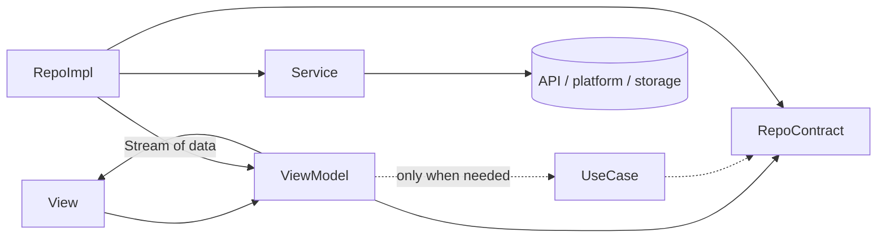

# Enterprise MVVM

A large-scale Flutter boilerplate. The UI layer is views and Cubit view models. The data layer is repositories and services. A `domain` folder holds immutable models and repository contracts so that layer stays pure Dart.

The package name is `enterprise_mvvm`. The project folder is `flutter_bloc_boilerplate`.



## Run

Generated code is not committed. Create it once, then run a flavor:

```bash
dart run build_runner build --delete-conflicting-outputs
flutter run -t lib/main_dev.dart --dart-define-from-file=config/dev.json --flavor dev
flutter run -t lib/main_staging.dart --dart-define-from-file=config/staging.json --flavor staging
flutter run -t lib/main_prod.dart --dart-define-from-file=config/prod.json --flavor prod
```

`lib/main.dart` is the dev entrypoint. Pass `--flavor` as well: Android and iOS use a separate application id for each flavor, so a flavorless build is not a complete install. Dev uses in-memory auth and does not need a backend. Staging and prod register the real Dio services against the placeholder base URL in `config/`.

`config/*.json` holds the flavor, base URL, and the HTTP log switch. Do not put secrets there.

### Demo accounts

Password for every account is `123456`.

| Email | Roles |
| --- | --- |
| `member@demo.com` | member |
| `admin@demo.com` | admin |
| `both@demo.com` | member and admin |
| `limited@demo.com` | member, with an empty server permission set |

The fake API's first access token is expired. `me` rejects it and `refresh` rotates it, so token refresh can be exercised without a server.

## Layout

| Path | Responsibility |
| --- | --- |
| `lib/app` | Bootstrap, composition root, router, role shells |
| `lib/core` | Config, failures, networking, session contracts, access, theme, shared UI |
| `lib/features/<feature>` | `data`, `domain`, and `ui` for one area of the product |
| `tool/` | `new_feature.dart` and `new_role.dart` |

A view (`ui/<screen>/<name>_screen.dart`) renders state and forwards actions. A view model is a Cubit with methods, not events. Move a screen to `Bloc` only when it needs an event transformer such as `restartable` or `droppable`.

A repository owns one kind of data: caching, retry, refresh, and mapping into `Result<T>` or a `Stream`. A service is a stateless wrapper around one source. A use case exists only when logic merges repositories, is complex, or is reused. View models otherwise call repositories directly.

Names follow the role: `LoginScreen`, `LoginViewModel`, `LoginState`, `AuthRepository`, `AuthRepositoryImpl`, `AuthApiService`. Shared widgets live in `core/ui`.

## Rules the test enforces

`test/architecture/layer_rules_test.dart` fails the build when any of these are broken:

- `domain` does not import `data`, `ui`, `package:flutter`, or `dio`
- `ui` does not import `data`
- `core` does not import `features` or `app`, so it can move to `packages/core` later
- a feature does not import another feature's `data` or `ui` (`domain/models` is allowed)
- a repository implementation depends on its own contract, not on another repository
- `package:get_it` is imported only under `lib/app`
- imports are package imports
- a file that is only `export` lines is rejected

`BaseViewModel.run` is the command. It emits loading, maps `Result` to success or failure, and ignores a second call while the first is running. Ordinary screens can use `ViewState<T>` (`idle`, `loading`, `success`, `failure`). `AsyncView` renders those four states the same way on every screen. `PaginatedViewModel` covers refresh, load-more, end-of-list, and a load-more error that keeps the rows already shown.

Failures carry an l10n key. View models do not format sentences.

## Session and roles

The session is app-wide data, so it lives in the repository, not in a Cubit. `AuthRepositoryImpl` implements both `AuthRepository` and `SessionRepository`. It restores the session, persists the active role, and expires the session when the network layer emits `AuthEvents.sessionExpired`. `core/network` never imports a feature.

The router listens to that stream. An unknown session stays on the splash screen. An unauthenticated user goes to login, and the intended location is kept. An authenticated user lands on the active role shell, or on the remembered location when that role can open it. A route the active role cannot open redirects to that role's home.

`SessionViewModel` is a thin view over the same stream for the role switcher and the logout button.

Permissions are not `if (role == admin)` checks. `AccessPolicy.can` uses the active role as the ceiling. When the backend sends permissions, they can only narrow that ceiling. The server still has to enforce access on every request.

Dependency injection has three scopes:

- **app** — config, network, storage, the session repository
- **session** — opened after login, dropped on logout
- **role** — dropped and recreated when the active role changes

Role view models are created under the shell route, so they close when the shell is replaced.

### Add a feature

```bash
dart run tool/new_feature.dart orders
dart run tool/new_feature.dart orders --use-case
dart run build_runner build --delete-conflicting-outputs
```

The generator adds the screen, view model, domain model, repository contract, service, DTO, mapper, repository implementation, route, `registerOrders()`, a fake, and a test. A use case is created only with `--use-case`.

### Add a role

```bash
dart run tool/new_role.dart student
```

That adds the enum value, the permission, the role-to-permission entry, the shell, and one line in `lib/app/role_modules.dart`. Domain and data stay shared. The router and the session repository do not change.

### When a role should be a new app

Keep a role in this app when it is the same product with a different shell: member and admin, student and teacher, buyer and seller. One binary, one release, screens composed from the same features.

Split a role into its own app when the store listing, the release cycle, or the screen set diverges: a rider app, a customer app, and a restaurant app. One router should not try to be all of them. The new app depends on the same `core`.

Move `lib/core` to `packages/core` when that second app appears. Nothing in `core` imports `app` or `features`, so the move is mechanical. A workspace `pubspec.yaml` at the repo root then lists both apps and the package:

```yaml
workspace:
  - apps/member
  - apps/rider
  - packages/core
```

## Design system

Colors, spacing, and radii live in `lib/core/theme`. Widgets read `ColorScheme`, `AppSpacing`, `AppRadii`, and the `AppGradients` theme extension. `ShimmerBox`, `ShimmerList`, `CachedImage`, `GlobalButton`, and `GradientScaffold` are the shared building blocks. Assets and the Inter font are referenced through `flutter_gen` (`lib/gen`, generated).

English and Bengali strings are in `lib/l10n`. `flutter gen-l10n` runs as part of `flutter analyze` and `flutter test`.

## Networking

`AuthInterceptor` attaches the bearer token. `TokenRefreshInterceptor` handles a 401 with a single in-flight refresh: concurrent 401s wait on one refresh, then retry once. A failed refresh emits `AuthEvents.sessionExpired`. Logging runs only for dev and staging, and it redacts `Authorization` plus password and token fields. Prod forces HTTP logs off even if the define is set.

## Checks

```bash
dart format --set-exit-if-changed lib test tool
flutter analyze
flutter test --coverage
```

Tests are fakes first. `mocktail` is used only to verify an interaction, such as a submit that must not re-enter. Coverage includes repositories, view models, token refresh, permission checks, widget tests for login and the role shells, router redirects, a DI smoke test for every flavor, and the architecture test.

## Release

- Build with `--obfuscate --split-debug-info=build/debug-info`.
- Keep secrets out of the repo and out of `config/`.
- Leave HTTP logging off in prod. The app already forces this.
- Sign the Android and iOS release builds with your own keys. The debug signing config in Gradle is only there so a local release build can run.
- Confirm the prod flavor resolves `AuthApiServiceImpl`, not `FakeAuthApiService`.

## Native flavors

Dev, staging, and prod install side by side.

| Flavor | Android application id | iOS bundle id | Display name |
| --- | --- | --- | --- |
| dev | `com.enterprise.mvvm.dev` | `com.enterprise.mvvm.dev` | MVVM Dev |
| staging | `com.enterprise.mvvm.staging` | `com.enterprise.mvvm.staging` | MVVM Staging |
| prod | `com.enterprise.mvvm` | `com.enterprise.mvvm` | MVVM |

Dart entrypoints alone do not change the bundle id. The Android product flavors and the iOS schemes do.
