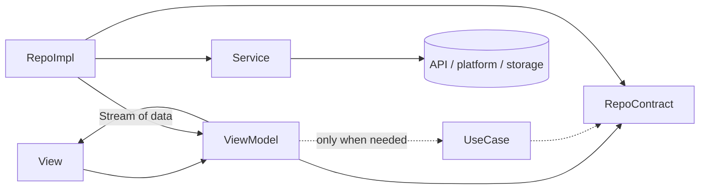
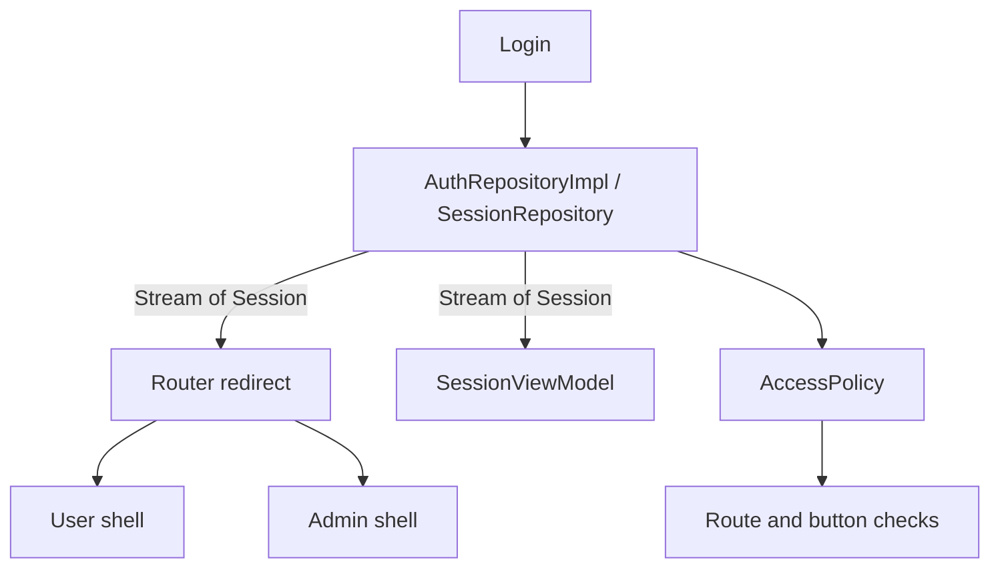

# Enterprise MVVM Flutter boilerplate

Build the app in the existing empty folder [`flutter_block_boilerplate`](flutter_block_boilerplate) with Dart package name `enterprise_mvvm` (org `com.enterprise.mvvm`). Confirm the installed Flutter and Dart versions with `flutter --version` and target the current stable SDK.

## Architecture

The structure follows Flutter's official app-architecture guide: a **UI layer** (Views and ViewModels) and a **data layer** (Repositories and Services). Cubit is the ViewModel implementation, which the guide allows because state management is a free choice. Clean Architecture's dependency inversion is layered on top through a `domain` folder.



Responsibilities:

- **View** (`ui/<screen>/<name>_screen.dart`): composition of widgets. Renders ViewModel state and forwards user actions. Only trivial logic: show/hide on a flag, animation, layout, simple routing.
- **ViewModel** (`ui/<screen>/<name>_view_model.dart`): a `Cubit` that turns repository data into UI state and exposes methods (the guide's "commands"), never events. One View, one ViewModel. Move to `Bloc` only when a screen needs event transformers (debounce, `restartable`, `droppable`).
- **Repository** (`data/repositories`): the source of truth for one kind of data. Owns caching, retry, refresh, polling, and error mapping, and returns `Result<T>` or a `Stream` when data changes. Maps DTOs to domain models. Never aware of other repositories.
- **Service** (`data/services`): a stateless wrapper around one data source (REST API, secure storage, platform plugin). No business logic.
- **Use case** (`domain/use_cases`, optional): only when logic merges several repositories, is complex, or is reused by several ViewModels. ViewModels otherwise call repositories directly. The folder exists but the generator creates a use case only with `--use-case`.
- **Domain models and repository contracts** (`domain/models`, `domain/repositories`): immutable models and abstract repository interfaces, in pure Dart.

### Naming

Classes are named after their architectural role, and names that clash with the Flutter SDK are avoided: `LoginScreen`, `LoginViewModel`, `LoginState`, `AuthRepository`, `AuthRepositoryImpl`, `AuthApiService`. Shared widgets live in `core/ui`, not `core/widgets`.

### Dependency rules (enforced by test, not just convention)

- `domain` imports nothing from `data`, `ui`, `package:flutter`, or `dio`
- `ui` never imports `data`
- `core` never imports `features` or `app`, so it can later move into `packages/core` mechanically
- A feature never imports another feature's `data` or `ui` (another feature's `domain/models` is allowed)
- A repository implementation imports only its own contract and never another repository. Combining data happens in a ViewModel or use case.
- `package:get_it` is imported only under `lib/app/` (the composition root). ViewModels, repositories, services, and widgets receive dependencies through constructors.
- Package imports only, and no barrel files (a file made only of `export` lines fails the test)

### ViewModel base

- `BaseViewModel<S>` extends `Cubit<S>`: `safeEmit` (no emit after close), and `run(Future<Result<T>>, ...)` which sets loading, maps the `Result` to success or failure, and ignores re-entry while running. This is the Cubit equivalent of the guide's Command pattern, so views do not manage loading and error flags by hand.
- `ViewState<T>`: sealed `idle | loading | success(T) | failure(Failure)` for ordinary screens. Feature-specific states (like login) can still be their own sealed classes.
- `PaginatedViewModel` mixin: page or cursor loading, refresh, load-more, end-of-list, and error-with-retry. Lists are the core of catalog, orders, and feed screens, so this is built once.

## Scale and roles

The same feature slice is what large products use. An orders, catalog, cart, tracking, or payments area is another folder with the same three layers and its own ViewModels. Realtime (location, order status) is a service feeding a repository `Stream`, which ViewModels observe. The boilerplate does not ship maps, sockets, or payments, but `core/services` defines the seams (logger, crash reporter, analytics, connectivity, feature flags) with no-op defaults so projects plug real implementations in without touching features.

Two role situations stay separate:

- **Same app, different shells** (user/admin, student/teacher, buyer/seller). One binary. The session carries roles. The router picks a shell. This is what the boilerplate includes.
- **Different products** (rider vs customer vs restaurant). When the stores, release cycles, and screens diverge, split into separate apps that share `core`. That split is documented, not built. One router should not try to be Uber.

Roles are not checked with scattered `if (role == admin)` calls. A user has a set of roles and one active role. Screens and routes ask for a permission.

### Session ownership

The session is app-wide state, so it lives in the data layer, not in a Cubit:

- `core/session/` defines `Session` (user plus active role), a minimal `SessionUser` (id, display name, roles, permissions), and an abstract `SessionRepository` exposing `Stream<Session>`, the current session, `switchRole`, and `expire`.
- `AuthRepositoryImpl` implements both `AuthRepository` and `SessionRepository`. It restores the session on start, persists the active role, and listens to `AuthEvents.sessionExpired` from the network layer.
- The router listens to the `SessionRepository` stream (`refreshListenable`). `SessionViewModel` is a thin ViewModel over the same stream for UI that needs it (role switcher, logout button).

### Role modules

Each role contributes a `RoleModule` (contract in `core/access`): its `AppRole`, home path, shell routes, navigation destinations, and any role-scoped dependency registrations. Shells and role modules live in `app/roles/<role>/` because they compose screens from several features. The router and shells are built from a single list in `lib/app/role_modules.dart`. Adding student/teacher later is:

1. an `AppRole` enum value
2. one `RolePermissions` entry
3. one `RoleModule` and shell in `app/roles/<role>/`
4. one line in `role_modules.dart`

Domain and data stay shared. No router or session code changes. `tool/new_role.dart` generates steps 1 to 4.

### Permissions

`RolePermissions` is the default role-to-permission map. `AccessPolicy.can(session, permission)` also honors permissions sent by the backend (token claims or `/me`) when present, so the server stays the authority and the app only hides what the user cannot use. The server must enforce access independently.

### Role switching and scopes

DI has three scopes: app, session, and role. Logout disposes the session scope; switching role disposes the role scope. Role-scoped ViewModels are created under the shell route, so they are closed when the shell changes and no stale state leaks between roles.



## Stack

- **State**: `flutter_bloc` Cubits as ViewModels, `equatable` states as Dart 3 sealed classes
- **DI**: manual `get_it` used only as the composition root in `lib/app/di`, with scopes and one `registerX()` per feature. Everything downstream uses constructor injection (no `injectable`, so registration stays reviewable).
- **Routing**: `go_router` with a redirect driven by the `SessionRepository` stream through a `refreshListenable`, and an `AppRoutes` constants class (no route strings in views)
- **Network**: `dio`, auth interceptor, token refresh interceptor, redacted logging interceptor, `DioException` mapped to typed failures
- **Result type**: a small sealed `Result<T>` in core (no `dartz` / `fpdart`)
- **Storage**: `flutter_secure_storage` for tokens, Hive for theme, locale, and active role
- **JSON**: `json_serializable` for DTOs only. Domain models and states are plain immutable Dart classes so ViewModels do not depend on codegen
- **Assets and fonts**: `flutter_gen` for typed asset and font constants (no `google_fonts` runtime dependency)
- **Config**: `--dart-define-from-file=config/<flavor>.json` for base URL and feature switches. Secrets never live in the repo.
- **Lint**: `flutter_lints` plus `always_use_package_imports`, `prefer_single_quotes`, `avoid_print`, `prefer_const_constructors`, `unawaited_futures`, `directives_ordering`, and analyzer `strict-casts`, `strict-inference`, `strict-raw-types`
- **Tests**: `bloc_test` with hand-written fakes first, and `mocktail` only to verify interactions

Dev flavor uses in-memory fake services so `flutter run -t lib/main_dev.dart --dart-define-from-file=config/dev.json` works with no backend. Staging and prod swap in the real `Dio` services and a placeholder base URL. The fake services are only registered by the dev flavor and assert they are never used in prod.

## Layout

```
flutter_block_boilerplate/
  config/             dev.json, staging.json, prod.json (no secrets)
  lib/
    main_dev.dart
    main_staging.dart
    main_prod.dart
    app/
      app.dart, bootstrap.dart, role_modules.dart
      di/             composition root: get_it, scopes, registerX()
      router/         go_router, guards, AppRoutes
      roles/
        user/         user_role_module.dart, shell, home screen + view model
        admin/        admin_role_module.dart, shell, home screen + view model
    core/
      config/         AppFlavor, AppConfig
      error/          Failure, exceptions, failure-to-message mapping
      result/         Result
      network/        dio client, interceptors (auth, refresh, logging), AuthEvents
      storage/        secure + preferences, TokenStore
      session/        Session, SessionUser, abstract SessionRepository
      access/         AppRole, Permission, RolePermissions, AccessPolicy, RoleModule contract
      services/       AppLogger, CrashReporter, AnalyticsService, ConnectivityService, FeatureFlags (interfaces + no-op defaults)
      theme/          Material 3 light/dark, tokens, ThemeExtensions, ThemeCubit
      observer/       AppBlocObserver
      ui/             BaseViewModel, ViewState, PaginatedViewModel,
                      shared widgets (button, text field, shimmer, cached image,
                      error, empty, AsyncView, offline banner)
    features/
      auth/
        data/
          services/       auth_api_service, auth_local_service (stateless)
          dto/            request/response DTOs + mappers
          repositories/   auth_repository_impl (also implements SessionRepository)
        domain/
          models/         User, ...
          repositories/   abstract auth_repository
          use_cases/      optional, generated only with --use-case
        ui/
          login/
            login_screen.dart
            login_view_model.dart
            login_state.dart
            widgets/
          session/        session_view_model.dart (thin, over the session stream)
      <other_feature>/    same shape
    l10n/                 app_en.arb, app_bn.arb via gen-l10n
  tool/
    new_feature.dart
    new_role.dart
  test/
    architecture/         layer_rules_test.dart
    fakes/                FakeAuthRepository, FakeSessionRepository, in-memory storage
    core/                 result, token refresh, access policy
    features/auth/        repository, session restore, login view model, session view model, login screen widget test
    app/                  router redirect and role guard, role shells widget test, DI smoke test
  .github/workflows/ci.yml
  README.md
```

## Auth slice (the template)

- **Access** (`core/access`): `AppRole.user` and `AppRole.admin`. `Permission` values such as `viewUserHome` and `viewAdminHome`. `RolePermissions` is the default map from role to permissions. `AccessPolicy.can(session, permission)` is what widgets and the router call.
- **Domain**: `User` model and the abstract `AuthRepository` (`login`, `logout`, `restore`). No mandatory use cases: `LoginViewModel` calls the repository directly. Add a use case only when a flow merges repositories, is complex, or is reused.
- **Data**: `AuthApiService` (`POST /auth/login`, `POST /auth/refresh`, `POST /auth/logout`) and `AuthLocalService` (tokens, persisted active role). `UserDto` serializes roles and maps to `User` and `SessionUser`. `AuthRepositoryImpl` implements `AuthRepository` and `SessionRepository`, restores the session on start, rejects `switchRole` for a role the user does not have, persists the chosen role, and expires the session on `AuthEvents.sessionExpired`. Dev binds `FakeAuthApiService`. Fake accounts, password `123456`: `user@demo.com` (user), `admin@demo.com` (admin), `both@demo.com` (both). The fake service also simulates token expiry so refresh can be exercised.
- **UI**: `LoginViewModel` states `initial | loading | success | failure`. `SessionViewModel` is a thin wrapper that exposes the current session, `switchRole`, and `logout` to shells.
- **Flow**: splash while the session is unknown. Unauthenticated goes to login, remembering the intended location. Authenticated goes to the active role shell (`/user` or `/admin`), or to the remembered location if the active role can access it. A route the active role cannot access redirects to that shell. Logout clears secure storage and the session scope. A user with both roles gets a switch control on both shells.

Shell screens stay thin: current user, active role, theme toggle, language toggle, logout, and the switch when more than one role exists.

## Networking hardening

- `AuthInterceptor` attaches the bearer token from `TokenStore`.
- `TokenRefreshInterceptor` handles 401 with a single-flight refresh: concurrent 401s wait on one refresh call, then retry once. If refresh fails, it emits on `AuthEvents`.
- `AuthRepositoryImpl` listens to `AuthEvents.sessionExpired` and expires the session. `core/network` never imports a repository or ViewModel, so `core` stays independent of features.
- The logging interceptor is enabled only in dev and staging, and redacts the `Authorization` header and password or token fields.
- Failures map to user messages through l10n keys, never hardcoded strings in ViewModels.

## Design system

Port the reusable widgets already built for earlier projects (`ShimmerBox`, `ShimmerList`, `CachedImage`, `GlobalButton`, `GradientScaffold`) into `core/ui` as `const`-friendly `StatelessWidget`s, with explicit `ColorScheme` constructors and `ThemeExtension` gradients. Add `AsyncView<T>`: given a `ViewState<T>` it renders shimmer, empty, error-with-retry, or content, so every screen handles all states the same way. Colors, spacing, and radii are tokens, not literals in widgets.

## Bootstrap

`bootstrap(AppFlavor)` in [`lib/app/bootstrap.dart`](flutter_block_boilerplate/lib/app/bootstrap.dart):

- `WidgetsFlutterBinding.ensureInitialized()`
- load `AppConfig` from dart-defines
- build the composition root (`lib/app/di`) for that flavor
- install `FlutterError` / platform dispatcher hooks (routed to `CrashReporter`) and `AppBlocObserver`
- `runApp` with theme and locale state provided above the router, and the router listening to the `SessionRepository` stream

Entrypoints are three lines each: `lib/main_dev.dart`, `lib/main_staging.dart`, `lib/main_prod.dart`.

## Deliberate differences from the official guide

- **Cubit instead of `ChangeNotifier`**: the guide treats `ChangeNotifier` as a conditional recommendation and state management as a preference. `BaseViewModel.run` covers what Commands do.
- **Feature-first folders**: the guide does not prescribe a folder layout. Feature-first scales better for large teams and role modules.
- **A `domain` folder** holding models and repository contracts. The guide keeps abstract repositories in the data layer. The separate folder lets the architecture test prove `domain` is pure Dart.
- **No `freezed` by default**: the guide only recommends code generators and warns about their build-time cost. Plain immutable models stay readable, and a project with many large models can opt in.

## Generation and verification

1. `flutter create --org com.enterprise.mvvm --project-name enterprise_mvvm .` inside `flutter_block_boilerplate` (platforms the SDK enables by default).
2. Add dependencies, then write core, app, features, tests, CI, and README.
3. `dart run build_runner build --delete-conflicting-outputs` for DTO `*.g.dart` files and `flutter_gen`. Generated files are not committed; CI generates them.
4. `dart format --set-exit-if-changed .`, `flutter analyze`, and `flutter test --coverage` must pass. Tests are fakes-first (`test/fakes`); `mocktail` is used only to verify interactions. They cover:
   - unit tests for every repository, service, and ViewModel: login, session restore, persisted active role, `switchRole` rejection, permission checks including server-provided permissions
   - token refresh (concurrent 401s trigger exactly one refresh, failed refresh expires the session)
   - widget tests for views: login screen, role shells, and the role switcher
   - router redirect and role guard tests
   - a DI smoke test that builds each flavor's container and resolves every registration
   - the architecture test (layer rules, repository rules, `get_it` placement, cross-feature imports, barrel files)
5. `tool/new_feature.dart <name> [--use-case]` generates the screen, ViewModel and state, domain model, abstract repository, service, DTO and mapper, repository implementation, route entry, `registerX()` skeleton, plus a fake and test stub. A use case is generated only with `--use-case`. `tool/new_role.dart <name>` generates the enum value, permission entry, `RoleModule` and shell, and registry line.
6. README documents flavor run commands, the demo accounts, naming conventions, the feature and role checklists (generator-backed), and a release checklist (`--obfuscate --split-debug-info`, no secrets in the repo, logging off in prod, signing). It also states when a new role stays in this app and when it should become a separate app sharing `core`, and how `core` becomes `packages/core` with Dart workspaces when a second app appears.
7. Native flavors (optional, last): Android `productFlavors` and iOS schemes with per-flavor application id, name, and icon so dev, staging, and prod can be installed side by side. Dart-only entrypoints do not give separate bundle ids, which is why this step exists.
